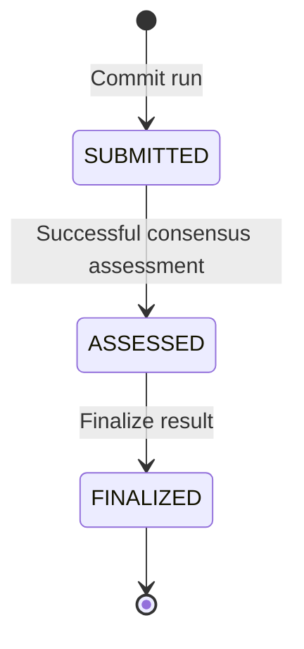

# MethodLock architecture

## Trust problem

Benchmark organizers compare numbers submitted by parties with an incentive to optimize the reported result. A fast latency can be misleading if a participant silently omits preprocessing, uses fewer samples, changes a quality metric, or relies on unsupported exceptions. Plain numeric validation cannot interpret these methodology differences.

MethodLock commits the agreed rules before submissions and produces an auditable requirement-level review. Its useful output is a comparability gate, rather than a generated benchmark opinion.

## State and authorization

Each `lock_protocol(protocol_json)` call creates an immutable protocol owned, for provenance purposes, by its sender. The contract supports multiple independent organizers; the owner has no later rewrite or override privileges. `submit_run(protocol_id, run_json)` records its sender as the entrant and binds both protocol hash and canonical submission SHA-256. IDs are monotonically allocated by contract state, never predicted in the frontend.

Anyone may pay for `assess_methodology(run_id)` and `finalize_result(run_id)`. Neither operation accepts a caller-provided verdict. Assessment runs exactly once successfully, and finalization cannot precede it or repeat. A reverted assessment leaves the submission available for a retry. This is permissionless evaluation against committed inputs, not access-controlled judging.

State progression:

Each of those writes also has its own blockchain transaction lifecycle. `ACCEPTED` is not final success. The frontend waits for `FINALIZED` and a successful execution result. Finalized reverts, no-majority outcomes, and validator/leader timeouts do not show success.

## Deterministic requirements

| Requirement | Check |
| --- | --- |
| `DATASET_ID`, `DATASET_VERSION` | Exact identity/version match |
| `DATASET_SAMPLES` | Integer, positive, absolute difference <= locked sample tolerance |
| `BATCH_SIZE` | Positive integer, exact locked batch size |
| `QUALITY_BPS` | Integer 0–10000 and >= locked threshold |
| `LATENCY_US` | Positive integer measurement in microseconds |
| `HARDWARE` | Nonempty bounded string disclosure |

Missing disclosures yield `UNKNOWN/DISCLOSURE_MISSING`; invalid numeric values and booleans yield deviations. Numeric arithmetic is integer-based. The quality metric name and evaluation method are checked semantically against evidence. Hardware string presence does not attest hardware identity.

## Semantic consensus

`assess_methodology` copies committed state into memory before entering nondeterministic code. Each participating validator calls the same audit task independently through `gl.vm.run_nondet_unsafe`:

| Requirement | Interpretation |
| --- | --- |
| `TIMING` | Whether the reported metric includes every required stage |
| `QUALITY_METHOD` | Whether the quality evaluation uses the locked metric/method |
| `EXECUTION_EVIDENCE` | Whether committed attached config/measurement details support the report and disclosures |

The leader returns three structured findings, each with requirement ID, status, code, source ID, quote, and reason. The contract validates completeness, uniqueness, allowed enums, bounded reasons, and exact quote membership. Satisfaction/deviation requires a source quote; unknown uses an empty citation. Execution-evidence satisfaction must cite an attached item, rather than the report alone.

The validator independently derives the findings, validates the proposal, and compares the complete ordered `(requirement_id, status, code)` signature. Reasons and quote choice can differ. This is substantive re-evaluation, not a JSON-shape-only validator. Unit tests exercise agreement, decision disagreement, and differing reason wording.

The audit prompt explicitly treats evidence as untrusted data, rejects unsupported certification/exception claims, gives explicit contradiction priority, and never assumes authentic execution. This reduces prompt-injection risk but is not a formal security guarantee.

## Evidence and authority

The protocol is the organizer’s authoritative standard for this competition. The evidence packet is a frozen, public text snapshot. The MVP deliberately makes no external real-world authenticity determination: source descriptions are provenance claims, not verified URLs. Evidence cannot change under a mutable URL between validators. A missing attached item is insufficient evidence rather than an invented observation.

For real adoption, accept signed runner manifests and output files keyed by content digest, explicit immutable dataset artifacts, independent replay records, and attestation roots. Fetching arbitrary entrant URLs inside validators would require immutable snapshot pinning, size limits, fetch-failure classifications, and SSRF defenses. These are not silently approximated by trusting a URL label.

## Result policy

Any `DEVIATION` -> `PROTOCOL_DEVIATION`; otherwise any `UNKNOWN` -> `INSUFFICIENT_EVIDENCE`; otherwise `COMPARABLE`. Finalization freezes the workflow status without introducing a second AI decision. Eligibility requires finalization plus comparability. Rank ascending latency only within one protocol. The frontend labels ranks as applying to the loaded page; it does not claim a global rank from incomplete pagination.

## Bounds and operations

- Protocol JSON <=12,000 characters; text fields <=1,800 each.
- Run JSON <=32,000 characters; report <=8,000; up to eight evidence items with text <=2,500 each.
- Protocol capacity 10,000; run capacity 100,000; pagination <=20 records.
- All writes are append-only or one-way state transitions; users must not publish personal or secret data.
- Studionet development service and test faucet can be unavailable or rate limited. RPC errors retain hashes for later tracking. Failed network submission may be ambiguous if the RPC disconnects after accepting a signed transaction; inspect the account/Studio before retrying.
- No token custody, payouts, upgradability, deletion, or organizer override. No production key on the server.

## Continued development

Start with a DAO inference challenge that publishes signed runner reports. Add complete dataset content hashes, signed timing traces, runner identity/attestation, auditable independent replay, reviewer challenges with new evidence, and an indexer for global ranking. Assess disagreement rates and injection resilience on adversarial packets before any production certification or financial settlement use.

## SDK verification details

Reads pass `TransactionHashVariant.LATEST_FINAL` to the SDK. An older `stateStatus` option is ignored by the installed SDK and must not be used. Regression tests assert the actual read parameters. Transaction success additionally requires an approved consensus result (`MAJORITY_AGREE`, legacy result 6) plus successful leader execution; a finalized rejected proposal can still contain a leader `SUCCESS` receipt. Result 7 and execution rollback are both failures. Existing hashes can be tracked from the Transactions page without a signer, after verifying the transaction targets this MethodLock instance.

The protocol browser loads the recent ten protocols and protocols referenced by the current run page; older protocols can be loaded by ID. A newly locked protocol is discoverable before its first submission. These cases are regression tested.

Strict per-requirement consensus can fail on ambiguous inputs even when the overall likely outcome is insufficient evidence. An unapproved assessment leaves its run submitted and ineligible. The original vague-certification run demonstrates this limitation. A separately committed clarified packet supplies explicit methodology while leaving execution certification unsupported. No failed assessment is converted to a verdict by the frontend or organizer.
